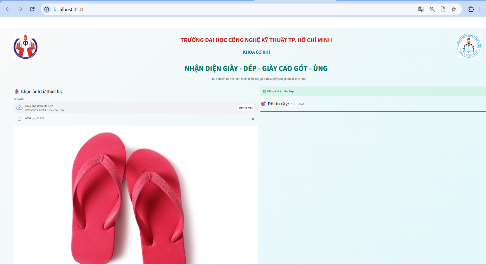
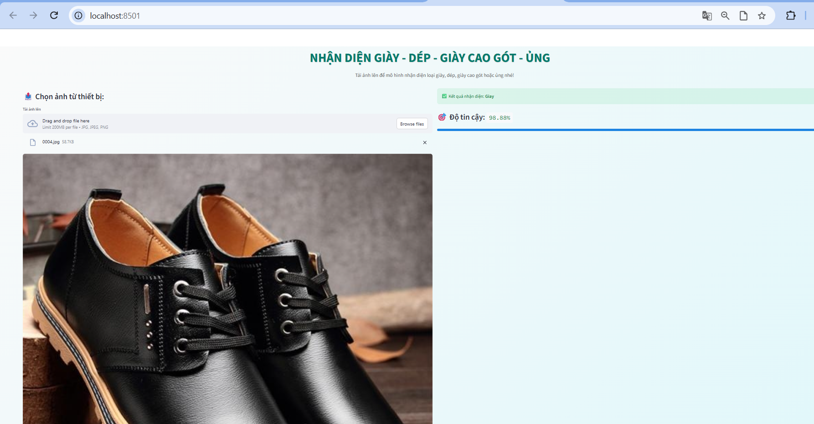
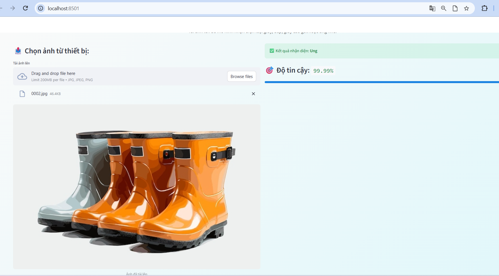
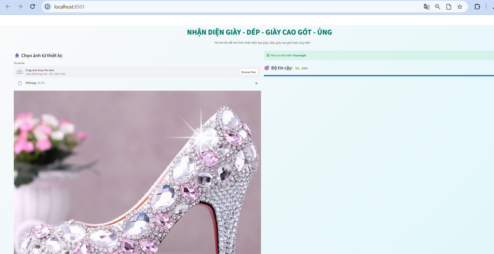

# AI_Footwear_Recognition with CNN

**A Streamlit web app that classifies footwear images into four categories: slippers/sandals, shoes, high heels, and boots.**

[](https://www.python.org/)
[](https://www.tensorflow.org/)
[](https://keras.io/)
[](https://streamlit.io/)

### Team

- **Huynh Vo Phuc Loc**
- **Nguyen Thien Nhan**

**Supervisor:** Dr. Cai Viet Anh Dung
**Institution:** Ho Chi Minh City University of Technology and Engineering

---

## Table of Contents

1. [Overview](#overview)
2. [Demo Workflow](#demo-workflow)
3. [Classes](#classes)
4. [Model Architecture](#model-architecture)
5. [Project Structure](#project-structure)
6. [Installation](#installation)
7. [Usage](#usage)
8. [Troubleshooting](#troubleshooting)
9. [How Prediction Works](#how-prediction-works)
10. [Notes](#notes)
11. [Authors](#authors)

---

## Overview

This project trains a small convolutional neural network (CNN) with Keras and serves it through a Streamlit interface. The user uploads a photo (`.jpg`, `.jpeg`, or `.png`), and the app returns the predicted footwear class together with a confidence score. If the model is not confident enough, the app reports **Unknown** instead of guessing.

### Features

- Upload an image from your device and get a prediction in a moment
- Four-class classification: slipper/sandal, shoe, high heel, boot
- Confidence score shown as a percentage and a progress bar
- Header with university and faculty logos, and a footer with team information

---

## Demo Workflow

1. Open the app in your browser.
2. Click **Browse files** and choose a footwear image.
3. The uploaded image is previewed on the left.
4. The predicted class and confidence appear on the right.

---

## Classes

The model outputs four classes, in this order:

| Index | Label in code | Meaning |
| --- | --- | --- |
| 0 | `Dep` | Slippers / sandals |
| 1 | `Giay` | Shoes |
| 2 | `Giaycaogot` | High heels |
| 3 | `Ung` | Boots |

---

## Model Architecture

`Nhom_3.keras` is a `Sequential` CNN that takes **180 × 180 × 3** RGB images.

| # | Layer | Details |
| --- | --- | --- |
| 1 | Data augmentation | RandomFlip (horizontal), RandomRotation (±0.1), RandomZoom |
| 2 | Rescaling | 1/255 |
| 3 | Conv2D + MaxPooling2D | 16 filters, 3×3, ReLU, same padding; pool 2×2 |
| 4 | Conv2D + MaxPooling2D | 32 filters, 3×3, ReLU, same padding; pool 2×2 |
| 5 | Conv2D + MaxPooling2D | 64 filters, 3×3, ReLU, same padding; pool 2×2 |
| 6 | Dropout | rate 0.2 |
| 7 | Flatten | – |
| 8 | Dense | 128 units, ReLU |
| 9 | Dense | 128 units, ReLU |
| 10 | Dense (output) | 4 units, linear (logits) |

- **Parameters:** about 4.0 million (4,005,668)
- **Optimizer:** Adam (learning rate 0.001)
- **Loss:** Sparse categorical cross-entropy (`from_logits=True`)
- **Metric:** Accuracy
- **Saved with:** Keras 3.10.0

> Data augmentation layers are only active during training; they are bypassed at inference time.

---

## Project Structure

```
AI_Footwear_Recognition/
├── test/                # Sample images for trying out the app
├── Nhom_3.py            # Streamlit application
├── Nhom_3.keras         # Trained 4-class model (used by the app)
├── 1.keras              # Earlier 3-class model (not used by the app)
├── logo_ute.png         # University logo (header, left)
├── logo_khoa.jpg        # Faculty logo (header, right)
└── README.md
```

---

## Installation

### 1. Clone the repository

```bash
git clone https://github.com/Dong-quan/AI_Footwear_Recognition.git
cd AI_Footwear_Recognition
```

### 2. (Recommended) Create a virtual environment

```bash
python -m venv venv
# Windows
venv\Scripts\activate
# macOS / Linux
source venv/bin/activate
```

### 3. Install dependencies

```bash
pip install streamlit==1.50.0 tensorflow==2.20.0 keras==3.10.0 numpy pillow
```

---

## Usage

### Run the App

1. Open the project folder in **VS Code**.
2. Open a new terminal and run:

```bash
streamlit run Nhom_3.py
```

3. Open the local URL printed in the terminal (usually `http://localhost:8501`).
4. Use the sample images in the `test` folder (or any footwear image) to try out the application.

> Run the command from the project folder, so that the model and logo files are found.

### Expected Output






---

## Troubleshooting

The web app may load slowly the first time because the model file is large (about 48 MB).
If it doesn't load properly, please check the following:

- Python or library version mismatches (use the versions in `requirements.txt`)
- Files may not be opened or placed correctly: `Nhom_3.py`, `Nhom_3.keras`, `logo_ute.png`, and `logo_khoa.jpg` must be in the same folder, and the terminal must be opened in that folder
- The error "model not found" means `Nhom_3.keras` is missing or was renamed

---

## How Prediction Works

1. The uploaded image is resized to **180 × 180** pixels.
2. It is converted to an array and a batch dimension is added.
3. The model returns raw logits; a **softmax** turns them into probabilities.
4. The class with the highest probability is selected.
5. If the highest probability is **below 0.8**, the result is shown as **Unknown**; otherwise the class name is displayed.

---

## Notes

- `Nhom_3.keras`, the logo files, and `Nhom_3.py` must stay in the **same folder**, because the app loads them by relative path.
- `Nhom_3.keras` is about 48 MB because it also stores the optimizer state. It is under GitHub's 100 MB limit, but you can shrink it to roughly 16 MB by re-saving it with `model.save("Nhom_3.keras", include_optimizer=False)`.
- The pinned versions in `requirements.txt` match the Keras version used to save the model. Newer Streamlit releases may deprecate the `use_container_width` argument used in the app.

---

## Authors

- **Huynh Vo Phuc Loc**
- GitHub: [Dong-quan](https://github.com/Dong-quan)
